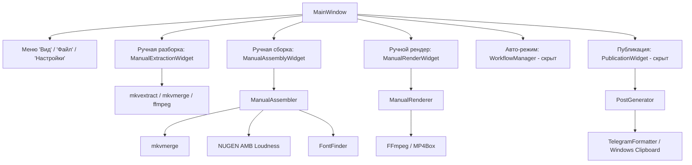

# DubbingTool — Архитектура, Цели и Руководство по Проекту

> **Документ актуализирован:** Ноябрь 2026  
> **Проект:** DubbingTool (C++17 / Qt 6.10 / CMake / Ninja / MSVC)  
> **Назначение:** Инструмент автоматизации и ручной подготовки релизов студии озвучивания и дубляжа «ТО Дубляжная».

---

## 1. Цели и Назначение Проекта

**DubbingTool** — это специализированное настольное приложение для релизеров и звукорежиссеров. Оно решает задачу полного производственного цикла подготовки медиафайлов (серий аниме, мультфильмов и сериалов) к релизу:

1. **Разбор исходников (Demuxing):**
   - Извлечение видеопотока, аудиодорожек, субтитров, глав (chapters) и встроенных шрифтов из сырых раздач (RAWs / HDTV / Web-DL в форматах MKV, MP4, TS).
2. **Сборка релизного мастер-контейнера MKV (Muxing):**
   - Упаковка чистого видеоряда, русской дорожки дубляжа/закадра (с нормализацией громкости), оригинальной японской/английской дорожки, полных субтитров и субтитров только с надписями.
   - Встраивание всех необходимых TTF/OTF шрифтов в контейнер MKV.
   - Корректная расстановка метаданных (языки `rus`/`jpn`, флаги `default`, `forced`, имена дорожек, тайминги глав).
3. **Подготовка видео для онлайн-плееров (Hardsub MP4 Render):**
   - Рендеринг MP4 с «вшитыми» надписями (хардсаб) для плееров, не поддерживающих ASS-субтитры (DubTV, Kodik, Anime365, Animelib).
   - Исторический модуль `ConcatTbRenderer` (кодировавший только узкий блок ТБ в конце серии) полностью удален в связи с отменой ТБ. На Этапе 4 пайплайн рендера обновляется на базе профилей HandBrake/FFmpeg с битрейтом аудио 320 kbps.
4. **Форматирование и генерация публикаций (Post Generation):**
   - Автоматическое составление текста постов для Telegram, VK и сайта проекта с расстановкой тегов, номеров серий, ссылок и форматирования.
   - Поддержка фирменного буфера обмена Telegram Desktop с сохранением форматирования (жирный, курсив, скрытые ссылки).

---

## 2. Новые Вводные от Заказчика и Цели Рефакторинга

### 2.1. Предпосылки и Причины Рефакторинга

Ранее в проекте разрабатывались две экспериментальные ветки:
1. **Портирование интерфейса на QML / Fluent UI** (`qt_qml_rework`).
2. **Пакетный фоновый режим без участия пользователя** (`feature/batch-unattended-autoflow`).

По итогам пересмотра бизнес-процессов студии **оба этих направления были официально закрыты и дропнуты**:
- QML-интерфейс признан избыточным усложнением, замедляющим разработку и порождающим визуальные артефакты при рендеринге окон на Windows. Основным и единственным UI остаётся стабильный Qt Widgets.
- Пакетный unattended-режим оказался неприменим на практике: исходные видеорелизы слишком разнообразны (разные кодеки, дорожки, рассинхроны), и релизеры всегда выполняют контроль и сведение вручную.
- Инструмент решено сфокусировать на двух самых востребованных и часто используемых экранах: **«Ручная разборка»** и **«Ручная сборка»**.

---

### 2.2. Прямые Вводные от Заказчика (Требования)

#### А. Изменения по заливу и дистрибуции:
1. **ТБ не делаем, каст нигде не указываем:** титры благодарности в конце видео и в титрах субтитров больше не размещаются.
2. **Разделение сезонов по площадкам:**
   - Релизы **НОВОГО** сезона публикуются только на собственном портале **DUBTV.PRO** и в закрытый архив MKV.
   - Релизы **ПРОШЛОГО** сезона по-прежнему выкладываются в основные каналы Telegram и группу VK.
3. **Загрузка MP4:** готовый MP4-видеоряд с вшитыми надписями заливается на **dubtv.pro**, **Kodik**, **Anime365**, **Анимелиб**.
4. **Карточка релиза:** карточка для поста на DUBTV.PRO формируется через веб-админку сайта.
5. **Тайминги на сайте:** на DUBTV.PRO вручную проставляются тайминги опенингов и эндингов для быстрого пропуска в плеере.

#### Б. Пожелания по Сборщику (Manual Assembly):
1. **Фокус на ручных операциях:** по умолчанию отображаются три основные рабочие вкладки («Ручная разборка», «Ручная сборка», «Ручной рендер»). Фокус при запуске приложения устанавливается на «Ручную сборку».
2. **Отказ от шаблонов релизов:** шаблонами релизов (`ReleaseTemplate`) релизеры не пользуются, привязку ручной сборки к ним убрать (тем более что ТБ больше нет). Важно лишь удобство быстрого отключения/включения субтитров или надписей.
3. **Сборка напрямую из MP4/видеоконтейнера:** добавить возможность собирать MKV сразу из исходного видеофайла без предварительного извлечения (демуксинга) видео и звука в отдельные файлы на диске.
4. **Выбор аудиодорожки из контейнера:** если в исходном видеофайле несколько аудиодорожек — показывать модальное окно выбора дорожки с подробной информацией о языке, кодеке и формате.
5. **Пресеты авторов субтитров:** в поле «Автор перевода» добавить выпадающие варианты частых шаблонов (`Crunchyroll`, `Netflix`, `Дубляжная`) с сохранением возможности ввода произвольного текста вручную.
6. **Скрытие второстепенных вкладок:** вкладки «Автоматический режим» и «Публикация» скрыть с главного экрана, но оставить возможность включить их через меню `Вид` (для редких сценариев или автора проекта).
7. **Общая панель логов и прогресса:** лог операций, прогресс-бар и кнопка «ОТМЕНА» вынесены из скрытого авто-режима в общий нижний `QSplitter`, обеспечивая видимость процесса на всех вкладках.

#### В. Предстоящие задачи по Рендеру (Следующий этап):
1. **Перевод пресетов HandBrake в ffmpeg:** студия подготовила обновленные пресеты кодирования в HandBrake. Требуется сконвертировать их параметры в CLI-аргументы `ffmpeg` для встроенного движка рендера.
2. **Повышение битрейта аудио:** изменить битрейт кодирования звука в пресетах рендера с 256k на **320 kbps**.

---

### 2.3. Главные Цели Рефакторинга

1. **Минимизация Time-to-Market (TTM) релиза:** сократить число шагов, кликов и ожидания от момента скачивания сырого файла до готового MKV. Релизер не должен тратить время на предварительный демуксинг звука и ручной ввод типовых авторов.
2. **Ликвидация мертвого и избыточного кода (Technical Debt):**
   - Полное удаление генерации титров ТБ, таблиц ширины символов для балансировки каста, диалогов стилей ТБ.
   - Избавление от неиспользуемых полей в моделях и реестре `AppSettings`.
3. **Чистый, сфокусированный интерфейс:** релизер открывает программу и сразу попадает на нужную вкладку сборщика без информационного шума (скрыты авто-режим, публикация, выбор шаблонов).

---

### 2.4. Сводная Таблица: Было vs Стало

| Было (Legacy) | Стало (Текущий процесс) | Причина изменений |
|---|---|---|
| В конец каждого релиза вшивался блок ТБ (Титры Благодарности) со списком каста актёров, звукорежиссёров и переводчиков. | **ТБ полностью отменено.** Каст в видеоряде не указывается. | Ускорение производства, упрощение видеоряда, переход на карточки на сайте. |
| В диалоге настроек настраивались шрифты и стили ТБ под разные разрешения (1080p, 720p, 360p). | **Вкладка «Стили ТБ» удалена** из настроек, мёртвый код генерации диалогов ТБ удалён из `AssProcessor`. | Неактуальность функционала стилей ТБ. |
| Ручная сборка требовала обязательного выбора профиля шаблона (`ReleaseTemplate`). | **Шаблоны отвязаны от ручной сборки.** Все параметры задаются напрямую в форме. | Релизеры собирают разные тайтлы вручную; привязка к шаблону создавала лишние клики. |
| Для ручной сборки требовалось предварительно извлечь видео и аудио в отдельные файлы. | **Добавлена прямая сборка из контейнера (MP4/MKV).** | Экономия дискового пространства и времени на демуксинг. |
| При наличии нескольких дорожек в контейнере приходилось демуксить вручную. | **Встроен модальный выбор аудиодорожки** с распознаванием языка, формата и каналов через `mkvmerge -J`. | Удобство при сборке из сырых Web-DL с несколькими дорожками. |
| Автор субтитров вводился только вручную (риск опечаток). | **Выпадающий список шаблонов:** `Crunchyroll`, `Netflix`, `Дубляжная` + свободный ввод. | Стандартизация именования дорожек субтитров. |
| Все вкладки отображались одновременно. | Неиспользуемые вкладки («Автоматический режим», «Публикация») **скрыты по умолчанию**; переключаются через меню `Вид`. Панель логов и отмены вынесена в общую нижнюю часть окна. | Фокус релизера на основных рабочих вкладках (**Ручная разборка**, **Ручная сборка**, **Ручной рендер**). |

---

### 2.5. Статус Реализации и Дорожная Карта

- [x] **Этап 1: Миграция базы знаний и правил Cursor -> Antigravity**
  - Создан корневой `AGENTS.md` и модульные правила в `.agents/rules/`.
  - Заархивированы все планы и архитектурные отчеты в `docs/plans/`.
- [x] **Этап 2: Рефакторинг ручной сборки и интерфейса под новые вводные**
  - Удалена панель шаблонов и блок ТБ из `ManualAssemblyWidget`.
  - Реализован выбор звука из видеоконтейнера (`useAudioFromVideo`) с парсингом дорожек через `mkvmerge -J` и модальным окном.
  - Поле автора субтитров заменено на `QComboBox` с пресетами `Crunchyroll`, `Netflix`, `Дубляжная`.
  - Добавлено меню `Вид` в `MainWindow` с чекбоксами показа скрытых вкладок.
- [x] **Этап 3: Полная зачистка легаси ТБ из ядра и настроек**
  - Удалена вкладка «Стили ТБ» из `SettingsDialog` (`ui/settingsdialog.ui`).
  - Удалено хранение стилей ТБ из `AppSettings` (`appsettings.h`, `appsettings.cpp`).
  - Вычищено более 650 строк мёртвого кода из `AssProcessor` (таблица весов символов, балансировщик строк, генерация строк каста).
  - Убран выпадающий список стилей ТБ из `TemplateEditor`.
  - Все тесты проверены и успешно проходят (6/6).
- [ ] **Этап 4 (Предстоящий): Обновление пайплайна рендера**
  - Трансляция новых профилей HandBrake в аргументы `ffmpeg`.
  - Обновление пресетов рендера в `AppSettings`.
  - Повышение битрейта аудио до 320 kbps.

---

## 3. Архитектура Системы и Ключевые Модули

Приложение построено на базе **Qt 6 (Widgets)** и взаимодействует с внешними консольными утилитами через `QProcess` и абстракцию `IProcessRunner`.



### Основные компоненты (`src/`):

### 3.1. Ядро и Модели
- **`AppSettings` (`src/core/appsettings.h`, `.cpp`):**
  Синглтон настроек приложения. Хранит пути к внешним бинарникам (`mkvmerge`, `mkvextract`, `ffmpeg`, `MP4Box`, `AMBCmd`, `qBittorrent`), параметры подключения к Web UI qBittorrent, пресеты кодирования видео и категории логирования. Сохранение осуществляется в `QSettings`.
- **`ReleaseTemplate` (`src/models/releasetemplate.h`, `.cpp`):**
  Модель профиля релиза (название тайтла, студия, регулярные выражения тегов, ссылки на RSS, список актёров, шаблоны постов для VK/TG, пресет рендера).
- **`WorkflowManager` (`src/core/workflowmanager.h`, `.cpp`):**
  Оркестратор автоматического пакетного пайплайна (скачивание через qBittorrent -> демуксинг -> нормализация -> субтитры -> рендер -> публикация).

### 3.2. Ручная Разборка (`src/ui/manualextractionwidget.cpp`)
- Принимает входной файл (MKV, MP4, AVI, TS).
- Анализирует состав контейнера через `mkvmerge -J` или `ffprobe`.
- Позволяет извлечь:
  - Видеопоток без потерь.
  - Аудиодорожки (с декодированием в WAV/FLAC или as-is).
  - Субтитры (ASS / SRT / SUP).
  - Встроенные шрифты (attachments).
  - Главы (XML Matroska или OGM).

### 3.3. Ручная Сборка (`src/ui/manualassemblywidget.cpp`, `src/processing/manualassembler.cpp`)
- **Входные данные:**
  - Видеофайл (чистый видеоряд либо готовый MP4/MKV-контейнер).
  - Аудиодорожка (отдельный WAV/FLAC/AAC/M4A файл либо выбор дорожки прямо из исходного видео).
  - Субтитры (полные субтитры и/или отдельные надписи).
  - Дополнительные шрифты (папка со шрифтами или авто-поиск).
- **Выбор аудиодорожки из видео:**
  - Кнопка **«Из видео...»** запускает инспекцию контейнера (`mkvmerge --identify --identification-format json`).
  - При наличии нескольких дорожек пользователю открывается диалог с подробной информацией (Track ID, язык, кодек, число каналов, название).
- **Пресеты авторов перевода:**
  - Поле автора субтитров (`subAuthorComboBox`) снабжено готовыми пресетами: `Crunchyroll`, `Netflix`, `Дубляжная`.
- **Процесс сборки (`ManualAssembler`):**
  1. Вызов `FontFinder` для сканирования файла `.ass` и сбора всех используемых семейств шрифтов (`\fnFontName`).
  2. Поиск файлов шрифтов в системных каталогах (`C:/Windows/Fonts`, `AppData/Local/Microsoft/Windows/Fonts`) и локальных папках проекта.
  3. Формирование аргументов `mkvmerge`:
     - `--video-tracks <ID>` (динамический ID видеопотока из контейнера, полученный через `mkvmerge -J`).
     - `--audio-tracks <ID>` с переименованием в `Дубляж` / `Озвучка` и языком `rus`.
     - Добавление дорожки субтитров с языком `rus` и именем, включающим автора перевода (без пустых скобок `[]`).
     - Гарантированный порядок дорожек через `--track-order` (`[Video, Russian, Original, Signs, Subtitles]`).
     - Корректная обработка кода возврата `mkvmerge` (код `1` трактуется как предупреждение, а не фатальная ошибка).
     - Добавление каждого шрифта через `--attachment-mime-type application/x-truetype-font --attach-file ...`.
  4. Запуск процесса `mkvmerge` и отслеживание прогресса.

### 3.4. Обработка Субтитров (`src/processing/assprocessor.cpp`, `.h`)
- Анализ заголовков ASS (`[Script Info]`, `[V4+ Styles]`, `[Events]`, `PlayResX`, `PlayResY`).
- Разделение субтитров на полные и надписи по стилям (`signStyles`).
- Конвертация ASS в формат SRT (`convertToSrt`) с трансляцией базовых тегов оформления (`<b>`, `<i>`, выравнивания `{\anX}`).
- Замена строк и терминов по словарю автозамен (`applySubstitutions`).

### 3.5. Рендеринг Видео (`src/processing/manualrenderer.cpp`)
- **Хардсаб субтитров и надписей:**
  - Извлечение внутренней дорожки субтитров или использование внешнего файла `.ass`.
  - Наложение субтитров через видеофильтр `subtitles='...'`.
  - Кодирование видео через FFmpeg с аппаратным или процессорным ускорением (`libx264`, `libx265`, `hevc_nvenc`, `hevc_qsv`).
  - Упаковка глав через MP4Box.

### 3.6. Генератор Постов и Интеграция с Telegram (`src/processing/postgenerator.cpp`, `telegramformatter.cpp`)
- Генерация текста по настраиваемым шаблонам (`data/post_template_catalog.json`).
- Поддержка плейсхолдеров: `%SERIES_TITLE%`, `%EPISODE_NUMBER%`, `%TOTAL_EPISODES%`, `%SUB_AUTHOR%`, `%VOICEOVER_TYPE%`, `%RELEASE_BUILDER%` и др.
- **Telegram Desktop Rich Clipboard:**
  - Помещение данных в системный буфер обмена Windows в специальном формате Qt MimeType `application/x-td-field-tags`.
  - Позволяет вставлять пост в окно ввода Telegram Desktop уже с жирным шрифтом, курсивом, моноширинным текстом и кликабельными ссылками без разметки markdown-символами.

---

## 4. Внешние Зависимости

Для полной функциональности приложению требуются внешние консольные утилиты (настраиваются во вкладке **Настройки -> Пути к программам**):

| Утилита | Назначение | Обязательность |
|---|---|---|
| **mkvmerge** (MKVToolNix) | Инспекция контейнеров (`-J`), сборка мастер-файлов MKV, добавление шрифтов и глав | **Обязательно** для сборки |
| **mkvextract** (MKVToolNix) | Извлечение треков, глав, шрифтов и вложений из MKV | **Обязательно** для разборки |
| **ffmpeg / ffprobe** | Анализ медиа, декодирование/кодирование звука (AAC, FLAC), рендеринг MP4 | **Обязательно** для рендера |
| **MP4Box** (GPAC) | Упаковка MP4-контейнеров для веба с флагом `faststart` | Опционально |
| **NUGEN AMB** (`AMBCmd.exe`) | Профессиональная пакетная нормализация звука по стандарту EBU R128 (-23 LUFS / -16 LUFS) | Опционально (при наличии) |
| **qBittorrent** | Автоматическая загрузка торрентов через Web API | Опционально (для авто-режима) |

---

## 5. Сборка и Разработка (Windows)

### Окружение:
- **ОС:** Windows 10/11 x64
- **Компилятор:** MSVC (Visual Studio 2022 / 2026 Build Tools)
- **Qt:** Qt 6.10.2 (MSVC 2022 64-bit) по пути `C:\Qt\6.10.2\msvc2022_64`
- **Система сборки:** CMake 3.25+ и Ninja

### Команды сборки:
```cmd
:: Инициализация окружения компилятора и сборка в Release:
cmd /c "\"C:\Program Files (x86)\Microsoft Visual Studio\18\BuildTools\VC\Auxiliary\Build\vcvars64.bat\" && cd /d \"c:\Users\icehole\git\DubbingTool\" && cmake -B build -G Ninja -DCMAKE_BUILD_TYPE=Release -DCMAKE_PREFIX_PATH=C:/Qt/6.10.2/msvc2022_64 && cmake --build build --config Release"
```

### Запуск Unit-тестов:
```cmd
cmd /c "\"C:\Program Files (x86)\Microsoft Visual Studio\18\BuildTools\VC\Auxiliary\Build\vcvars64.bat\" && cd /d \"c:\Users\icehole\git\DubbingTool\" && ctest --test-dir build --output-on-failure"
```

### Развертывание библиотек (Deployment):
```cmd
cmd /c "\"C:\Program Files (x86)\Microsoft Visual Studio\18\BuildTools\VC\Auxiliary\Build\vcvars64.bat\" && C:\Qt\6.10.2\msvc2022_64\bin\windeployqt.exe c:\Users\icehole\git\DubbingTool\build\DubbingTool.exe"
```

---

## 6. Карта Исходных Файлов Проекта

```
DubbingTool/
├── CMakeLists.txt                 # Корневой файл сборки CMake (цели: DubbingTool, DubbingToolTestSupport, тесты)
├── build.bat                      # Скрипт быстрой сборки приложения
├── build-tests.bat                # Скрипт сборки и запуска тестов
├── data/
│   └── post_template_catalog.json # Каталог шаблонов постов для соцсетей
├── docs/                          # Технические отчеты, исследования и архив планов
│   ├── plans/                     # Архив всех архитектурных планов рефакторинга
│   ├── auto_concat_cfr_debug_report.md
│   └── telegram_clipboard_tags_format.md
├── src/
│   ├── core/                      # Ядро приложения
│   │   ├── appsettings.*          # Настройки приложения и реестра
│   │   ├── chapterhelper.*        # Парсинг и расчёт таймингов глав MKV/OGM
│   │   ├── processmanager.*       # Управление внешними процессами
│   │   └── workflowmanager.*      # Автоматический пакетный пайплайн
│   ├── models/
│   │   └── releasetemplate.*      # Модель настроек релиза тайтла
│   ├── processing/                # Алгоритмы обработки медиа
│   │   ├── assprocessor.*         # Обработка ASS субтитров, конвертация в SRT
│   │   ├── fontfinder.*           # Поиск используемых шрифтов в ASS и системе
│   │   ├── manualassembler.*      # Сборщик MKV через mkvmerge
│   │   ├── manualrenderer.*       # Контроллер кодирования видео
│   │   ├── postgenerator.*        # Шаблонизатор постов
│   │   ├── renderhelper.*         # Парсинг битрейта и аргументов ffmpeg
│   │   └── telegramformatter.*    # Бинарная разметка буфера обмена Telegram
│   └── ui/                        # Пользовательский интерфейс (C++ контроллеры)
│       ├── main.cpp               # Точка входа
│       ├── mainwindow.*           # Главное окно (меню Вид, переключение вкладок)
│       ├── manualassemblywidget.* # Виджет ручной сборки MKV
│       ├── manualextractionwidget.* # Виджет ручной разборки контейнеров
│       ├── manualrenderwidget.*   # Виджет ручного рендера MP4
│       ├── settingsdialog.*       # Диалог настроек путей и параметров
│       ├── templateeditor.*       # Редактор шаблонов релизов
│       └── ...                    # Вспомогательные модальные диалоги
├── ui/                            # Файлы Qt Designer (.ui)
└── tests/                         # Набор unit-тестов QtTest
    ├── chapterhelper_test.cpp
    ├── ffmpeg_smoke_test.cpp
    ├── fontfinder_test.cpp
    ├── manualrenderer_test.cpp
    ├── postgenerator_test.cpp
    └── telegramformatter_test.cpp
```
