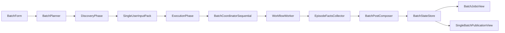

# План расширения до batch-серий

## Зафиксированные требования
- После нажатия `Start Batch` система должна работать автономно длительное время без дополнительных вопросов.
- Поддержать **два независимых формата пачки**: 1) диапазон серий через RSS/torrent, 2) список локальных MKV/MP4.
- Смешивать источники в одной пачке не требуется.
- Выполнение серий в v1 — **последовательное**; «параллельность» нужна только как массовый ввод данных заранее.
- Публикация в batch — **одна агрегированная** (единый пост по нескольким сериям), а не отдельный пост на каждую серию.
- Если часть серий завершилась с ошибкой, они все равно включаются в итоговый пост с явной пометкой статуса.
- При отклонении битрейта >3% в unattended-режиме используется политика `auto_rerender` (без диалога) с **автокоррекцией целевого битрейта** по фактической ошибке рендера.
- Компенсация битрейта должна быть **накапливаемой в рамках batch-запуска**: коэффициент, найденный на предыдущих сериях, применяется к следующим сериям того же запуска.
- Discovery-фаза в v1 работает в режиме `deep_probe` (максимально глубокий предварительный анализ для минимизации сюрпризов в execution).
- Для batch игнорируем `UseOriginalPath`: все серии работают в изолированной проектной структуре папок (как при выключенном `UseOriginalPath`).

## Что сейчас блокирует batch-режим
- В `MainWindow` используется один активный воркер `m_currentWorker` и один комплект состояния публикации `m_last*` в [src/ui/mainwindow.h](src/ui/mainwindow.h).
- `WorkflowManager` хранит одну серию (`m_episodeNumberForPost`, `m_episodeNumberForSearch`) и завязан на чтение/запись полей UI через `MainWindow*` в [src/core/workflowmanager.h](src/core/workflowmanager.h) и [src/core/workflowmanager.cpp](src/core/workflowmanager.cpp).
- `PublicationWidget` хранит данные одной серии (`m_episodeData`) в [src/ui/publicationwidget.h](src/ui/publicationwidget.h), а batch требует единый пост с блоками нескольких серий.
- Диалоги выбора (`multipleTorrentsFound`, `multipleAudioTracksFound`, `userInputRequired`, `signStylesRequest`) встроены в runtime-процесс и вызываются «по ходу», что ломает unattended-режим.

## Потенциальные проблемные места (выявлено до старта реализации)
- Часть обязательных вопросов появляется только после углубленного анализа файла серии:
  - выбор аудиодорожки (`multipleAudioTracksFound`) появляется только после probe контейнера;
  - выбор стилей надписей (`signStylesRequest`) возможен только когда есть доступный ASS (извлеченный или override);
  - missing fonts для финальной сборки выявляются после обработки/анализа субтитров и поиска шрифтов.
- Есть поздний runtime-вопрос, который по текущей логике возникает почти в конце рендера: `RerenderDialog` при отклонении битрейта >3% (`RenderHelper`).
- Для local-files режима есть риск перезаписи промежуточных файлов при `UseOriginalPath`, если несколько серий лежат в одной папке и используют одинаковые временные имена (`video.*`, `audio_original.*`, `subtitles_original.*`).
- Риск коллизий путей закрывается архитектурным решением: в batch `UseOriginalPath` не применяется.
- В шаблоне может быть включен `pauseForSubEdit`; без отдельного checkpoint это ломает требование «после старта больше не спрашивать».
- Часть текущих веток пишет значения обратно в UI (`findChild<QLineEdit*>`), что опасно даже при последовательной batch-обработке и должно быть убрано в конфиг job.

## Целевая архитектура (v1)

## Максимальный перечень вопросов к пользователю (для DiscoveryPhase)
- Цель discovery-фазы: собрать **все** ответы заранее, чтобы execution-фаза не показывала ни одного диалога.

### A) Вопросы конфигурации пачки (один раз на запуск)
- Режим источника: `RSS range` или `Local files`.
- Шаблон релиза.
- Политика на ошибки job: продолжать пачку или останавливать всю пачку.
- Политика по проблемным сериям в итоговом посте: включать с меткой `failed` (зафиксировано).
- Глобальные флаги сборки (если не задаются в шаблоне): normalize audio, decouple SRT/subs, fallback-поведения.

### B) Вопросы для RSS-range режима (по каждой серии при необходимости)
- Если найдено несколько релизов в RSS: какой торрент выбрать (`TorrentInfo.title`/`magnetLink`).
- Если не найдено релиза: пометить серию как `failed` или остановить пачку (по выбранной политике).

### C) Вопросы для Local-files режима (по каждой серии)
- Путь к исходнику (MKV/MP4) и номер серии.
- Проверка дубликатов номеров/путей и решение конфликтов (исправить номер, пропустить, отменить запуск).
- В batch пользовательский `UseOriginalPath` не используется; все файлы копируются/перемещаются в job-структуру.

### D) Вопросы, которые сегодня задаются runtime и должны быть перенесены в discovery
- Выбор аудиодорожки из нескольких (`AudioTrackInfo.id/codec/name/language`).
- Указание внешней русской аудиодорожки (если обязательна и не найдена автоматически).
- Маппинг отсутствующих шрифтов (`missingFonts` -> путь/замена).
- Указание времени эндинга/ТБ (`tbTimeRequired` + `tbTimeReason`).
- Указание XML глав или разрешение сборки без глав (`chaptersXmlPath` / `buildWithoutChapters`).
- Выбор стилей надписей из ASS (`signStylesRequest`).
- Решение по ререндеру при проверке битрейта (`RerenderDialog`: принять/отклонить корректировку параметров).
- Решение по ререндеру при проверке битрейта в batch зафиксировано: `auto_rerender`.
- Ручная правка субтитров (`pauseForSubEdit`) переносится в отдельный batch checkpoint до execution.

### E) Вопросы для формирования единой итоговой публикации
- Диапазон серии в заголовке batch-поста (авто из списка job, с учетом `failed`).
- Ссылки просмотра по каждой серии и платформе (Anime365/AnimeLib и т.д.), если нельзя вычислить шаблонно.
- Общие/пересекающиеся кредиты: правило дедупликации и порядок вывода блоков.
- Маркер статуса для проблемных серий в финальном тексте (формулировка и место в посте).

### E1) Зафиксированный формат финальной публикации
- Формируем **один общий релизный пост** для пачки серий.
- Заголовок должен содержать диапазон серий и общий статус релиза в стиле:
  - `▶️Серия: 12-13/13 **РЕЛИЗ ЗАВЕРШЕН**`
- Кредитные блоки (роли, звук, перевод, разметка, локализация, сборка) идут единым набором для поста.

#### Telegram (основной пост)
- Список эпизодов и ссылки находятся **внутри основного поста**.
- Для каждого эпизода строго блочная структура:
  1. отдельная строка с номером эпизода (например, `12 серия`),
  2. отдельная строка `Anime365` со ссылкой,
  3. отдельная строка `AnimeLib` со ссылкой,
  4. пустая строка перед следующим эпизодом.
- Порядок эпизодов — по возрастанию номера.
- Для `failed` эпизодов блок не удаляется: показывается номер эпизода и явная статусная пометка (без «тихого» пропуска).

#### VK (основной пост + комментарий)
- Основной пост в VK содержит общий релизный текст и кредиты (без длинного списка эпизодных ссылок).
- Список эпизодов со ссылками публикуется в **комментарии** к посту.
- Формат комментария для каждого эпизода аналогичен Telegram:
  1. отдельная строка с номером эпизода,
  2. отдельная строка `Anime365` со ссылкой,
  3. отдельная строка `AnimeLib` со ссылкой,
  4. пустая строка между эпизодами.
- Для `failed` эпизодов правило то же: эпизод остаётся в списке с явной пометкой статуса.

### F) Definition of Done для discovery
- По каждой job заполнен `PrecollectedInputsForJob`.
- Нет задач в статусе `needsUserInput`.
- Собран `SingleUserInputPack` + финальный `BatchPostDraft`, подтвержденный пользователем одним действием.
- Для каждой серии выполнен `deep_probe` (контейнер/дорожки/главы и необходимые данные для стилей/шрифтов), чтобы execution не запрашивал доп. ввод.

### G) Как обыгрываем ручную правку субтитров в batch
- Ввести подфазу `SubtitleEditCheckpoint` между `DiscoveryPhase` и `ExecutionPhase`.
- Для каждой job заранее подготовить рабочий субтитровый файл (например, извлеченный или override) и показать единый список серий со статусами:
  - `readyForEdit`,
  - `editedConfirmed`,
  - `skipEdit`.
- Пользователь редактирует нужные серии в удобном порядке, затем подтверждает чекпоинт одной кнопкой `Continue Batch`.
- После подтверждения чекпоинта execution-фаза не останавливается на `pauseForSubEditRequest`; вместо этого использует зафиксированные файлы из `PrecollectedInputsForJob`.
- Если для серии включен обязательный edit, но подтвержденного файла нет — серия помечается `failed (subtitle edit incomplete)` еще до старта execution.
- В UI добавить быстрые действия: `Open file`, `Open folder`, `Mark edited`, `Revert to extracted`, чтобы не открывать отдельные модалки по одной серии.

## Этапы внедрения

### 1) Ввести двухфазную модель batch-задачи
- Добавить `BatchJobSpec` (jobId, sourceType, episodeForPost, episodeForSearch, sourcePath, templateSnapshot, runtimeFlags).
- Добавить `BatchRunSpec` (mode, stopPolicy, список `BatchJobSpec`) и `PrecollectedInputs` (все решения, требуемые для unattended-фазы).
- Разделить выполнение на:
  - `DiscoveryPhase`: собрать недостающие данные для **всех** job;
  - `ExecutionPhase`: выполнить все job без новых запросов к пользователю.
- Файлы для добавления: `src/core/batchjobspec.h`, `src/core/batchrunstate.h` (при необходимости `.cpp`).

### 2) Декуплировать `WorkflowManager` от `MainWindow`
- Заменить зависимости `m_mainWindow->findChild(...)` и `get*()` на явные поля входной конфигурации воркера.
- Передавать все override-пути/флаги (`audio`, `overrideSubs`, `overrideSigns`, `chapters`, `normalization`, `decouple`) через `WorkflowRunConfig` + `PrecollectedInputsForJob`.
- В execution-фазе запретить интерактивные ветки: если какой-то input не был собран в discovery, job сразу завершается с ошибкой «discovery incomplete».
- Изменяемые файлы: [src/core/workflowmanager.h](src/core/workflowmanager.h), [src/core/workflowmanager.cpp](src/core/workflowmanager.cpp), [src/ui/mainwindow.cpp](src/ui/mainwindow.cpp).

### 3) Добавить координацию последовательного unattended выполнения
- Реализовать `BatchCoordinator` с очередью job и **одним активным** `WorkflowManager`.
- Поддержать политики остановки: для v1 — продолжать пачку при ошибке отдельной серии, фиксируя статус `failed`.
- Ввести per-job статусы: `queued`, `discovering`, `needsUserInput`, `ready`, `running`, `done`, `failed`, `canceled`.
- Гарантия v1: после подтверждения `SingleUserInputPack` execution-фаза не открывает ни одного нового диалога.
- Проверку битрейта перевести в бездиалоговый режим: при превышении порога автоматически применять `auto_rerender` с пересчетом target bitrate.
- Добавить policy для автокоррекции:
  - на каждом шаге вычислять коэффициент `k = targetBitrate / actualBitrate`,
  - новый target: `nextTarget = clamp(targetBitrate * k, minBitrate, maxBitrate)`,
  - ограничить число попыток (`maxAutoRerenderAttempts`, например 2-3),
  - если после лимита отклонение все еще > порога — помечать серию `failed (bitrate out of bounds)`.
- Добавить `BatchBitrateCompensationState` (state на запуск пачки):
  - хранить агрегированный коэффициент компенсации (например, EWMA/median по успешным эпизодам),
  - перед стартом рендера новой серии применять этот коэффициент к исходному target bitrate,
  - после завершения серии обновлять коэффициент по фактическому результату,
  - сбрасывать состояние в начале нового batch-запуска.
- Файлы для добавления: `src/core/batchcoordinator.h`, `src/core/batchcoordinator.cpp`.

### 4) Batch UI для предварительного сбора данных
- В [ui/mainwindow.ui](ui/mainwindow.ui) и [src/ui/mainwindow.cpp](src/ui/mainwindow.cpp) добавить режим `Batch` с двумя подпотоками:
  - `RSS range mode`: шаблон + диапазон серий.
  - `Local files mode`: таблица файлов + номер серии + опциональные per-job overrides.
- Добавить экран `BatchReviewDialog` (или отдельную секцию), где пользователь **одним шагом** подтверждает все найденные неоднозначности:
  - выбор торрента для конкретной серии (если найдено несколько),
  - выбор аудиодорожки/стилей/путей, если это требуется,
  - подтверждение fallback-правил.
- Перед execution запускать валидацию completeness: не должно остаться job в `needsUserInput`.

### 5) Переработать публикацию и прогресс под несколько серий
- Вместо per-job публикации ввести `BatchPostComposer`, который собирает единый текст поста по завершенным сериям.
- Для каждой серии сохранять минимальный набор `BatchEpisodePublicationData`:
  - номер серии/диапазон,
  - view links по площадкам,
  - cast/кредиты (с правилами дедупликации),
  - флаги статуса (`done/failed`) для финального заголовка и явных меток проблемных серий.
- `PublicationWidget` оставить единым: показывать один итоговый markdown/html + инструменты копирования.
- Лог и прогресс отображать по текущей серии + общей шкале пачки (`готово X из N`) для длинного unattended-запуска.
- Изменяемые файлы: [src/ui/publicationwidget.h](src/ui/publicationwidget.h), [src/ui/publicationwidget.cpp](src/ui/publicationwidget.cpp), [src/ui/mainwindow.cpp](src/ui/mainwindow.cpp).

### 6) Тестовая стратегия до и после включения batch
- До рефакторинга: добавить тесты на формирование единых блоков публикации из нескольких серий в `BatchPostComposer`.
- Добавить unit-тесты для `BatchCoordinator` (discovery-фаза, completeness-check, последовательный прогон, fail одного job, завершение пачки).
- Добавить тесты агрегации итогового поста:
  - диапазон серий в заголовке (`12-13/13`, `РЕЛИЗ ЗАВЕРШЕН`),
  - блоки ссылок по каждой серии,
  - единые кредитные блоки без дублирования,
  - явные маркеры для `failed` серий в финальном тексте.
- Добавить тесты политики `auto_rerender`:
  - корректный пересчет нового target bitrate при известном `actualBitrate`,
  - остановка после `maxAutoRerenderAttempts`,
  - переход в `failed` при недостижении порога.
- Добавить тесты переноса компенсации между эпизодами:
  - после серии с систематическим отклонением следующая серия стартует с скорректированным target,
  - коэффициент обновляется только по валидным результатам,
  - при новом batch-run состояние компенсации начинается с baseline.
- Проверить, что существующие `ChapterHelper`/`TelegramFormatter` тесты проходят без изменений.

## MVP v1 (первый проход реализации)

### Цель первого прохода
- Получить рабочий batch-режим с двухфазным процессом (`deep_probe` -> единый ввод -> execution без диалогов) и одной итоговой публикацией.
- Не ломать существующий single-episode сценарий.

### Что входит в MVP (обязательно)
- `BatchJobSpec` / `BatchRunSpec` / `PrecollectedInputsForJob`.
- `BatchCoordinator` для **последовательного** запуска job.
- Discovery для двух источников:
  - `RSS range` (поиск кандидатов и сбор неоднозначностей),
  - `Local files` (валидация входов и подготовка job).
- Перенос runtime-вопросов в discovery-пакет:
  - torrent choice,
  - audio track choice,
  - chapters XML / build without chapters,
  - TB time,
  - sign styles,
  - missing fonts mapping,
  - subtitle edit checkpoint.
- Execution без интерактивных диалогов:
  - `auto_rerender` вместо `RerenderDialog`,
  - запрет `pauseForSubEditRequest` в runtime,
  - падение job при `discovery incomplete`.
- Единый `BatchPostComposer` + один итоговый экран публикации.
- Игнорирование `UseOriginalPath` в batch.

### Что НЕ входит в MVP (переносим в v1.1+)
- Расширенная настройка шаблонов форматирования failed-серий (гибкий DSL/конструктор).
- Параллельный запуск нескольких job.
- Отдельный UI-редактор правил дедупликации кредитов.
- Полный рефакторинг `PublicationWidget` под произвольные представления (достаточно одного итогового вида).

### Порядок реализации MVP (рекомендуемый)
1. Контракты batch-данных + фича-флаг.
2. Декуплинг `WorkflowManager` от live-UI (`WorkflowRunConfig`).
3. Discovery engine + `SingleUserInputPack`.
4. `SubtitleEditCheckpoint`.
5. `BatchCoordinator` execution (без диалогов, `auto_rerender`).
6. `BatchPostComposer` и итоговый экран публикации.
7. Тесты (координатор, компоновщик поста, критичные regression checks).

### Критерии приемки MVP
- На одной пачке из 2+ серий: после подтверждения discovery нет ни одного модального вопроса.
- При отклонении битрейта >3% срабатывает автоматический rerender с пересчетом target bitrate и ограничением попыток.
- После коррекции на ранних сериях следующие серии в этой же пачке используют накопленную компенсацию и реже требуют повторного ререндера.
- При падении одной серии остальные продолжаются, а итоговый пост содержит явную метку failed-серии.
- Single-episode режим проходит smoke/regression без изменения UX.

## Меры снижения рисков
- Ввести feature-flag `batchModeEnabled` и сохранить старый single-episode поток как fallback.
- Включать batch поэтапно: сначала local-files, затем RSS-range через отдельные internal toggles.
- Discovery-фаза должна быть полностью детерминирована и повторяема, чтобы не получать «новые вопросы» после подтверждения.
- Явно задокументировать ограничения v1: unattended only, без интерактивных диалогов во время выполнения.
- Явно задокументировать отличие batch от single: настройка `UseOriginalPath` в batch игнорируется ради целостности артефактов.

## Критерии готовности v1
- Пользователь задаёт пачку и больше не взаимодействует с UI до окончания.
- После одного шага подтверждения всех вводных не возникает новых вопросов от приложения.
- Серии обрабатываются последовательно и предсказуемо, без потери состояния между job.
- Для каждой job доступны: статус, лог, пути MKV/MP4, ошибки.
- В конце формируется один агрегированный пост в нужном синтаксисе (заголовок диапазона, блоки ссылок по сериям, общие кредиты).
- Single-episode режим работает как раньше (регрессионные тесты зелёные).