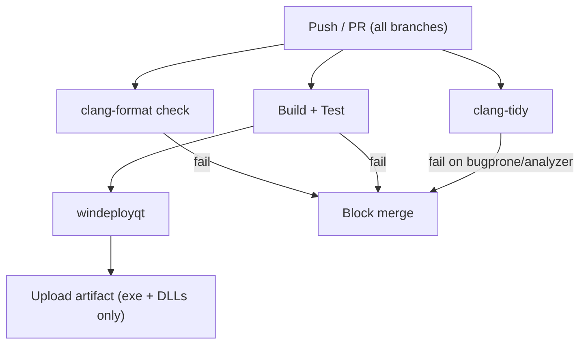

# CI Workflow Architecture Review

## Current State

Two workflow files:

- `[.github/workflows/windows-ci.yml](.github/workflows/windows-ci.yml)` -- main CI (build + clang-tidy)
- `[.github/workflows/test.yml](.github/workflows/test.yml)` -- "Ultimate Sanity Check", ручной dispatch, просто делает checkout и `dir`

## Problems Found

### 1. CRITICAL: CI не запускается на feature-ветках

```yaml
on:
  push:
    branches: ['main']
  pull_request:
    branches: ['main']
```

CI работает **только** при push в `main` или PR в `main`. Пока не создан PR, сломанный код на feature-ветке никто не увидит. Это то, что произошло сейчас -- мы запушили `feature/qt-multimedia-viewfinder` и CI даже не запустился.

**Fix:** Запускать CI на всех push/PR, либо использовать паттерн `'**'`.

### 2. HIGH: Расхождение версий Qt между CI и local dev

- **CI:** Qt `6.7.2` с `win64_msvc2019_64`
- **Local:** Qt `6.10.2` с `msvc2022_64`

Это 3 мажорных minor-версии разницы. API, доступный в 6.10.2 (например, некоторые сигнатуры `QMediaPlayer`), может отсутствовать в 6.7.2. Сборка может падать в CI при рабочем коде локально, или наоборот.

**Fix:** Обновить CI до Qt 6.10.2 (или хотя бы 6.8.x) и `win64_msvc2022_64`.

### 3. HIGH: clang-tidy -- чисто декоративный

```yaml
- name: Run clang-tidy
  run: |
    ...
    clang-tidy $file.FullName -p build --warnings-as-errors="" 2>&1 | Out-Default
  continue-on-error: true
```

Две проблемы:

- `--warnings-as-errors=""` -- ни одно предупреждение не фейлит шаг
- `continue-on-error: true` -- даже если шаг упадёт, job не провалится

Итого: clang-tidy **никогда не может сломать CI**. Его вывод теряется в логах, которые никто не читает.

**Fix:** Убрать `continue-on-error`, добавить хотя бы категории предупреждений в `--warnings-as-errors` (например bugprone, clang-analyzer). Или интегрировать через CMake `ENABLE_CLANG_TIDY` опцию, которая уже есть в CMakeLists.txt.

### 4. MEDIUM: Раздутый артефакт -- весь `build/`

```yaml
- name: Upload Build Artifact
  path: build/
```

Загружается **весь каталог `build/**` -- это obj-файлы, CMake cache, compile_commands.json, MOC-сгенерированный код и т.д. Для проекта такого размера это может быть 500MB-1GB+ при 90-дневном хранении.

**Fix:** Загружать только папку с деплоем (exe + DLL после windeployqt), или конкретный путь `build/DubbingTool.exe` + runtime DLLs.

### 5. MEDIUM: Нет проверки clang-format

Код-стандарт (user rules) **обязывает** использование clang-format, файл `.clang-format` есть в репозитории, но CI **не проверяет форматирование**. Это значит, что неотформатированный код может попадать в main.

**Fix:** Добавить шаг `clang-format --dry-run --Werror` по всем `.cpp`/`.hpp` файлам (или использовать `git-clang-format`).

### 6. LOW: Неэффективный запуск clang-tidy

PowerShell loop `Get-ChildItem + foreach` запускает `clang-tidy` **последовательно**, по одному файлу за раз. Для 20+ cpp-файлов это неэффективно.

**Fix:** Использовать `run-clang-tidy` (идёт с LLVM) который запускает проверку параллельно, или использовать CMake-интеграцию (`-DENABLE_CLANG_TIDY=ON`) прямо в шаге build.

### 7. LOW: `test.yml` -- мёртвый код

Файл `test.yml` ("Ultimate Sanity Check") только делает `checkout` + `dir`. Это очевидно отладочный остаток, не несёт ценности.

**Fix:** Удалить.

## Proposed Workflow Architecture




## Summary of Proposed Changes


| #   | Severity | Issue                          | Fix                                              |
| --- | -------- | ------------------------------ | ------------------------------------------------ |
| 1   | CRITICAL | CI ignores feature branches    | `branches: ['**']` or remove branch filter       |
| 2   | HIGH     | Qt 6.7.2 in CI vs 6.10.2 local | Update to Qt 6.10.x + msvc2022                   |
| 3   | HIGH     | clang-tidy never fails         | Remove continue-on-error, set warnings-as-errors |
| 4   | MEDIUM   | Entire build/ uploaded         | Upload only deployed exe + DLLs                  |
| 5   | MEDIUM   | No format check                | Add clang-format --dry-run step                  |
| 6   | LOW      | Sequential clang-tidy          | Use run-clang-tidy or CMake integration          |
| 7   | LOW      | Dead test.yml                  | Delete                                           |


