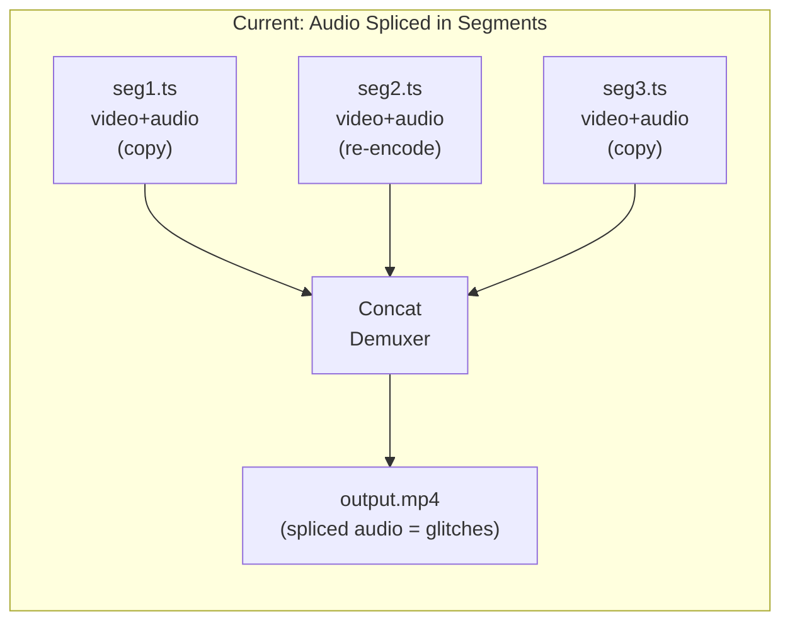
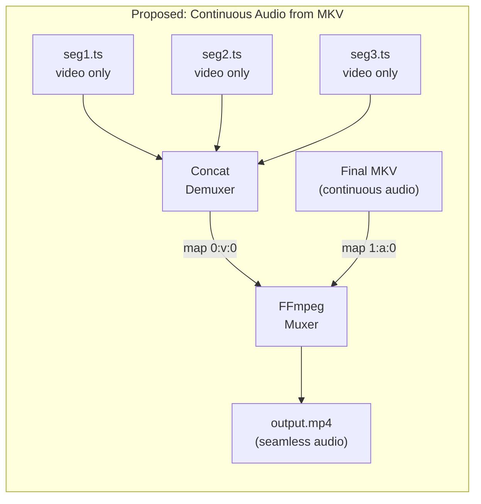

# Fix Concat Segment Boundary Artifacts

## Root Cause

The problem is NOT about margins, `+genpts`, or `duration` directives. It is **fundamentally about splicing AAC audio at segment boundaries in TS containers**.

Evidence from research and logs:

- **AAC encoder priming**: Each AAC segment has 2 frames of silence (priming samples) at the start for decoder warmup. When segments are concatenated, these priming frames create ~21-46ms gaps/overlaps at each boundary. This is the "audio repeat" the user hears.
- **Heterogeneous audio sources**: seg1/seg3 have stream-copied AAC from the MKV, while seg2 has freshly re-encoded AAC 192k. These have different AAC frame alignments, encoder delays, and timing characteristics. The concat demuxer cannot seamlessly stitch them.
- **Audio-video duration mismatch**: AAC frames are 1024 samples (~21ms at 48kHz). Video frames are 40ms at 25fps. These never align exactly, causing the concat demuxer to miscalculate segment offsets (audio is always slightly longer), which explains the visual "jump" too.
- **Total duration drift** confirms this: log shows output time `22:42.24` vs original `22:41.48` -- 0.76s of accumulated error across 3 segment boundaries.

## Solution: Don't Splice Audio At All

Instead of trying to fix audio boundaries, **eliminate them entirely**:

1. Make all TS segments **video-only** (add `-an`)
2. In the join step, take **audio from the continuous MKV track** (`m_finalMkvPath`)
3. The MKV audio runs from 0 to end with no splices -- perfect continuity

The sync between concatenated video and MKV audio is guaranteed because:

- seg1 video covers original time 0 to ~1272.04 (with B-frame tail)
- seg2 video (after trim) covers 1272.04 to 1299.76
- seg3 video covers 1299.76 to end
- **Total = original duration**, matching the MKV audio timeline exactly







## Files to Change

Only one file: [src/core/workflowmanager.cpp](src/core/workflowmanager.cpp)

### 1. `concatCutSegment1()` (~line 1711)

- For MP4 source: remove the MKV input entirely (only need video from MP4), add `-an`
- For MKV source: add `-an` to suppress audio
- Remove `-map 1:a:0` (no audio mapping needed)

Before:

```cpp
args << "-i" << m_mkvFilePath   // original MP4
     << "-i" << m_finalMkvPath  // assembled MKV — dubbed audio
     << "-to" << seg1EndStr
     << "-map" << "0:v:0"       // video from original MP4
     << "-map" << "1:a:0"       // dubbed audio from assembled MKV
     << "-c" << "copy";
```

After:

```cpp
args << "-i" << m_mkvFilePath   // original MP4 — video only
     << "-to" << seg1EndStr
     << "-map" << "0:v:0"
     << "-c:v" << "copy"
     << "-an";                  // no audio in segments
```

### 2. `concatRenderSegment2()` (~line 1754)

- Remove all audio-related args: `-c:a aac -b:a 192k`, `-map 0:a:0`, `-af atrim=...`, `-shortest`
- Add `-an`
- The `-map` should only have `0:v:0`

Remove:

```cpp
// Audio filter: trim to match video trim
if (bframeOverlap > 0.001)
{
    args << "-af" << QString("atrim=start=%1,asetpts=PTS-STARTPTS").arg(...);
}
// ...
args << "-c:a" << "aac" << "-b:a" << "192k"
     << "-map" << "0:v:0"
     << "-map" << "0:a:0";
// ...
args << "-shortest";
```

Replace with:

```cpp
args << "-map" << "0:v:0"
     << "-an";
```

### 3. `concatCutSegment3()` (~line 1901)

Same pattern as seg1: remove audio mapping, add `-an`.

Before (MP4 source):

```cpp
args << "-ss" << kfTimeStr
     << "-i" << m_mkvFilePath   // video
     << "-ss" << kfTimeStr
     << "-i" << m_finalMkvPath  // audio
     << "-map" << "0:v:0"
     << "-map" << "1:a:0"
     << "-c" << "copy";
```

After:

```cpp
args << "-ss" << kfTimeStr
     << "-i" << m_mkvFilePath   // video only
     << "-map" << "0:v:0"
     << "-c:v" << "copy"
     << "-an";
```

### 4. `concatJoinSegments()` (~line 1942)

Major simplification:

- Remove all probing code (no need for `duration` directives with video-only segments)
- Remove explicit `duration` directives from concat list (simple file list is enough)
- Add `m_finalMkvPath` as second input
- Map video from concat (input 0), audio from MKV (input 1)
- Use `-c:a copy` for stream-copy of MKV audio (it's AAC, compatible with MP4)
- Remove `-bsf:a aac_adtstoasc` (audio comes from MKV, not TS -- no ADTS conversion needed)
- Add `-shortest` to handle any tiny duration difference between concat video and MKV audio

```cpp
QStringList args;
args << "-y"
     << "-f" << "concat"
     << "-safe" << "0"
     << "-i" << QFileInfo(listPath).absoluteFilePath()
     << "-i" << m_finalMkvPath           // continuous audio source
     << "-map" << "0:v:0"               // video from concat segments
     << "-map" << "1:a:0"               // audio from MKV (Russian, default track)
     << "-c:v" << "copy"
     << "-c:a" << "copy"                // stream-copy AAC from MKV
     << "-movflags" << "+faststart"
     << "-shortest"                      // stop at shorter stream
     << m_outputMp4Path;
```

## Why This Works

- **No audio boundaries** = no AAC priming artifacts, no encoder delay mismatches
- **Video-only concat** = duration calculated from video timestamps only, no audio-induced offset errors
- **MKV audio is continuous** from 0:00 to end, naturally synchronized with the original video timeline
- The concat video timeline matches the MKV timeline because seg1+seg2+seg3 cover the same time range as the original
- Stream-copy audio from MKV is instant (no re-encoding needed since MKV already has AAC)

## Revert Previous Changes

The following changes from earlier attempts become unnecessary and should be reverted as part of this work:

- `duration` directive probing in `concatJoinSegments()`
- `-shortest` in `concatRenderSegment2()` (no audio to sync with)
- All margin calculations for seg2 input duration

