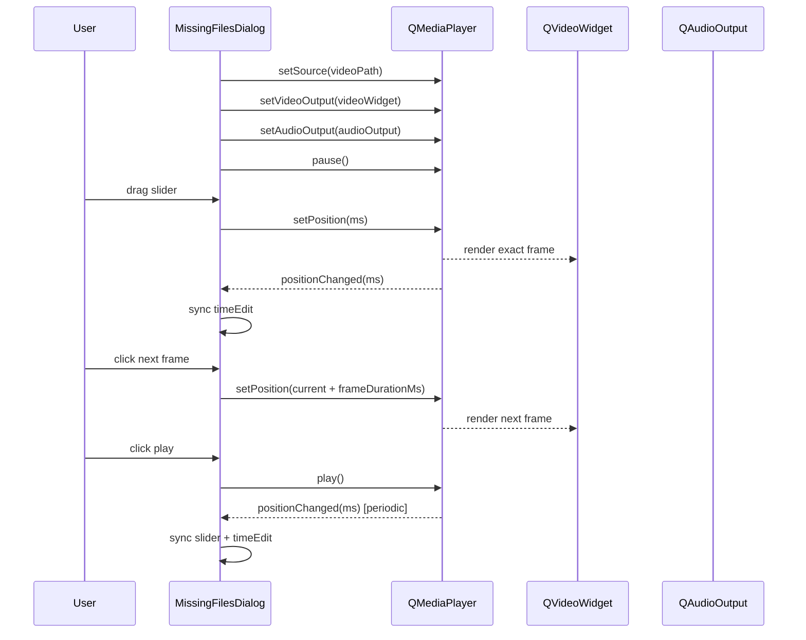

# Qt Multimedia Viewfinder

## Approach

Replace the async FFmpeg frame extraction pipeline with `QMediaPlayer` + `QVideoWidget` from Qt Multimedia module. Qt 6.10.2 uses FFmpeg as the default multimedia backend on Windows, so MKV and all codecs should work without new dependencies.

## Architecture

## Key components

- `QMediaPlayer` -- media decoding and playback control
- `QVideoWidget` -- renders video frames, embeds natively in Qt layout
- `QAudioOutput` -- audio playback (required by QMediaPlayer in Qt 6)
- `setPosition(qint64 ms)` -- seeking with millisecond precision
- `positionChanged(qint64)` signal -- real-time position feedback for slider sync
- Frame stepping: `setPosition(current + 1000.0/fps)` while paused

## Files to modify

### [`CMakeLists.txt`](CMakeLists.txt)

- Add `Multimedia MultimediaWidgets` to `find_package(Qt6 REQUIRED COMPONENTS ...)`
- Add `Qt6::Multimedia Qt6::MultimediaWidgets` to `target_link_libraries`

### [`src/ui/missingfilesdialog.h`](src/ui/missingfilesdialog.h)

Remove:
- `QProcess *m_ffmpegProcess` and all extraction pipeline members
- `m_extractionInProgress`, `m_pendingSeekTimeS`, `m_previewTempPath`
- Slots: `slotExtractionFinished`, `slotExtractionError`, `slotPreviewFrame`
- Methods: `requestFrameExtraction()`, `startExtraction()`, `showExtractedFrame()`

Add:
- `QMediaPlayer *m_mediaPlayer`
- `QVideoWidget *m_videoWidget`
- `QAudioOutput *m_audioOutput`
- Slot: `slotPlayerPositionChanged(qint64 position)` -- sync slider/timeEdit from player
- Slot: `slotMediaStatusChanged(QMediaPlayer::MediaStatus)` -- handle loaded/error

Keep:
- `m_fps`, `m_frameStepS`, `m_videoDurationS`, `detectFps()`
- `slotSliderValueChanged`, `slotTimeEditChanged`
- `slotPlayPause`, `slotNextFrame`, `slotPrevFrame`
- `syncSliderFromTimeEdit()`, `syncTimeEditFromSlider()`
- `sliderValueToSeconds()`, `secondsToSliderValue()`

### [`src/ui/missingfilesdialog.cpp`](src/ui/missingfilesdialog.cpp)

Constructor:
- Create `QAudioOutput`, `QMediaPlayer`, `QVideoWidget`
- `m_mediaPlayer->setAudioOutput(m_audioOutput)`
- `m_mediaPlayer->setVideoOutput(m_videoWidget)`
- Insert `m_videoWidget` into layout in place of `previewImageLabel`
- Connect `m_mediaPlayer->positionChanged` to `slotPlayerPositionChanged`
- Connect `m_mediaPlayer->mediaStatusChanged` to handle errors
- Remove all QProcess/extraction setup

`setVideoFile(path, durationS)`:
- Detect fps (keep existing `detectFps()`)
- `m_mediaPlayer->setSource(QUrl::fromLocalFile(path))`
- `m_mediaPlayer->pause()` -- load and show first frame paused
- Seek to initial position (~last 3 min)
- Configure slider range (keep frame-based units)

`slotPlayPause()`:
- If playing: `m_mediaPlayer->pause()`
- If paused: `m_mediaPlayer->play()`

`slotNextFrame()` / `slotPrevFrame()`:
- Ensure paused
- `m_mediaPlayer->setPosition(currentPos +/- frameDurationMs)`

`slotSliderValueChanged(value)`:
- Convert to milliseconds
- `m_mediaPlayer->setPosition(ms)`

`slotPlayerPositionChanged(qint64 pos)`:
- Convert ms to slider value and timeEdit
- Update UI (with sync guard to prevent loops)

Destructor:
- Remove temp file cleanup (no temp files)
- `m_mediaPlayer->stop()` (QMediaPlayer is a QObject child, auto-deleted)

### [`ui/missingfilesdialog.ui`](ui/missingfilesdialog.ui)

- Replace `previewImageLabel` (QLabel) with a plain `QWidget` named `videoContainer`
  (QVideoWidget will be created in code and inserted into this container's layout)
- Remove `previewFrameButton` ("Показать кадр") -- no longer needed, video is live
- Keep: `prevFrameButton`, `playPauseButton`, `nextFrameButton`, `timeSlider`, `timeEdit`, `openInPlayerButton`

## What stays the same

- FPS detection via ffprobe (`detectFps()`) -- still needed for frame-step calculation
- Slider: frame-based units (1 tick = 1 frame), same conversion functions
- TimeEdit: same H:mm:ss.zzz format, same sync logic
- "Открыть в плеере" button: same QDesktopServices::openUrl behavior
- `getTime()` return value: same format for workflow integration

## What to verify after build

1. MKV file loads and displays video
2. Audio plays during playback
3. `setPosition()` while paused shows the correct (not keyframe) frame
4. Frame step forward (+1 frame) visually changes to next frame
5. Frame step backward (-1 frame) visually changes to previous frame
6. Slider drag updates video smoothly
7. Playback position updates slider in real-time

## Fallback plan

If frame-accurate seeking does NOT work (shows keyframe instead of exact frame):
- Revert branch
- Keep current FFmpeg extraction viewfinder (already frame-accurate)
- Optionally add "Play in ffplay" button for audio preview

## Dependencies

**None new**. Qt Multimedia + MultimediaWidgets are part of Qt 6.10.2 installation.
`windeployqt` will automatically copy the multimedia plugins to the build folder.
