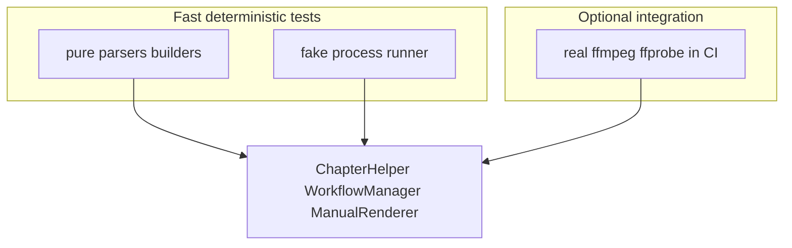

# План: система тестов DubbingTool

## Текущее состояние

- В [CMakeLists.txt](c:\Users\icehole\git\DubbingTool\CMakeLists.txt) при `BUILD_TESTING=ON` уже есть `enable_testing()`, Qt6::Test, статическая библиотека `FontFinderLib` и исполняемый [tests/fontfinder_test.cpp](c:\Users\icehole\git\DubbingTool\tests\fontfinder_test.cpp); `add_test` регистрирует `FontFinderTest`.
- CI в [windows-ci.yml](c:\Users\icehole\git\DubbingTool\.github\workflows\windows-ci.yml) собирает с `-DBUILD_TESTING=ON` и запускает `ctest`.
- Внешние процессы сосредоточены в [src/core/processmanager.cpp](c:\Users\icehole\git\DubbingTool\src/core/processmanager.cpp) (`QProcess`); «ветвистые» сценарии живут в больших классах ([workflowmanager.cpp](c:\Users\icehole\git\DubbingTool\src/core/workflowmanager.cpp), [manualrenderer.cpp](c:\Users\icehole\git\DubbingTool\src/processing/manualrenderer.cpp)).

## Целевая архитектура слоёв

- **Быстрый слой**: функции без сети и без реального `ffmpeg` — парсинг XML/JSON, сборка аргументов, экранирование путей, инварианты.
- **Компонентный слой**: те же менеджеры, но с **подменой** механизма запуска процесса (сигналы stdout/stderr/exit по сценарию).
- **Медленный слой (позже)**: 2–5 smoke-тестов с реальным бинарником в CI или вручную — только контракт «команда построена / код выхода».

## Этап 1 — расширить CMake и первый пакет тестов (минимальный рефакторинг)

1. **Переименовать/обобщить статическую библиотеку** в CMake (например `FontFinderLib` → `DubbingToolTestSupport` или оставить имя, но явно задокументировать как «общая тестовая статическая либа») и подключать к ней новые `.cpp`, как только они нужны тестам.
2. Добавить второй таргет, например `chapterhelper_test`, и зарегистрировать `add_test(NAME ChapterHelperTest ...)`.
3. Покрыть **чистые** API из [chapterhelper.h](c:\Users\icehole\git\DubbingTool\src\core\chapterhelper.h):
   - `parseMatroskaChapterXmlData`, `loadChaptersFromFile` (на файлах из [tests/test_data/](c:\Users\icehole\git\DubbingTool\tests\test_data)),
   - `parseFfprobeChaptersJson` (зафиксированные JSON-фрагменты в `test_data`),
   - `buildChapterTimingSeconds`, `writeMatroskaChapterXml` / `writeFfmetadata` / `writeOgmChapterText` (проверка содержимого через `QTemporaryDir` или сравнение с эталоном).
4. Для функций, которые принимают `ProcessManager*` (`extractEmbeddedChaptersToFile`, `applyChaptersToMp4`), на этапе 1 либо **не тестировать**, либо отложить до этапа 2.

Итог этапа 1: стабильный прирост покрытия без зависимости от версии `ffmpeg`.

## Этап 2 — подменяемый запуск процессов (ключ к state machine)

Сейчас [ProcessManager](c:\Users\icehole\git\DubbingTool\src\core\processmanager.h) — конкретный класс без виртуального интерфейса. Чтобы тестировать цепочки «запуск → вывод → завершение» детерминированно:

1. Ввести узкий интерфейс (условно `IProcessRunner` или `IExternalProcessService`) с методами в духе `start(program, args)`, `executeAndWait(...)`, сигналами/колбэками, совместимыми с тем, что ждут `ManualRenderer` / виджеты.
2. Реализация по умолчанию — текущий `ProcessManager` (минимальные изменения поведения).
3. Тестовая реализация — **Fake**: синхронно или через `QTimer::singleShot(0, ...)` эмулирует `readyRead*`, `finished`, ошибки старта.

После этого имеет смысл добавить тесты на **ограниченный конечный автомат**, например [ManualRenderer](c:\Users\icehole\git\DubbingTool\src/processing/manualrenderer.h) (`RenderState`): последовательность успешных `finished(0)` должна переводить состояние и собирать ожидаемые программы/аргументы (без реального `ffmpeg`).

`WorkflowManager` трогать только точечно: не выносить всё состояние сразу, а начать с **одной** выделенной функции (например нормализация шаблона команды / вставка `-map_chapters`, если вынесено в отдельную свободную функцию) — иначе объём рефакторинга непомерный.

## Этап 3 — версии ffmpeg и «не 100% случаев»

- Юнит-тесты хранят **фикстуры stdout/stderr** (несколько вариантов строк прогресса), а не живой вывод конкретной версии.
- Отдельно (опционально): job или помеченный тест `WITH_REAL_FFMPEG`, который в CI ставит один закреплённый билд `ffmpeg` и проверяет 1–2 команды (`-version`, простой `ffprobe` JSON). Это не даёт 100% версий, но ловит поломку PATH и грубые регрессии.

## Критерии готовности первой итерации «делаем»

- `cmake -DBUILD_TESTING=ON` + `ctest` проходят локально и в CI.
- Добавлены фикстуры в `tests/test_data/` и минимум один новый тестовый бинарник помимо `fontfinder_test`.
- Документировано в комментарии к CMake: как добавлять следующий модуль в тестовую статическую либу.

## Риски и ограничения

- Переименование `FontFinderLib` затронет только CMake/линковку тестов — основной `DubbingTool` не меняется.
- Вынесение интерфейса процесса затронет все места, где создаётся/передаётся `ProcessManager` — это отдельный коммит/PR после этапа 1.
